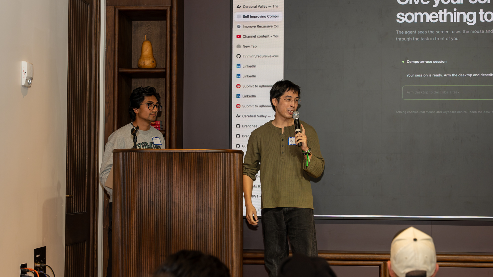
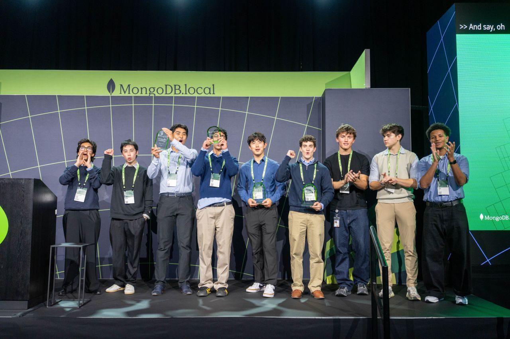
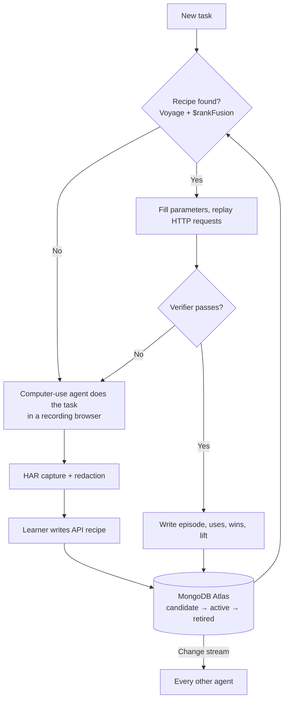

# Recursive Computer-Use Harness: Learning Layer

**An AI agent does a web task once. The harness learns the site's API calls from that run, and every later run replays them instead of clicking through the screen.**

🏆 **3rd place, MongoDB Harness Engineering Hackathon (NYC, September 2026)**

This is my fork of the team repo [`lhnminh/self-improving-computer-use`](https://github.com/lhnminh/self-improving-computer-use). This README covers the part I built: the MongoDB layer and the network-recipe learner.

| Project presentation | Awards ceremony |
|---|---|
|  |  |

## Results

I evaluated the learner on [WebShop](https://github.com/princeton-nlp/WebShop), a shopping benchmark from Princeton. WebShop scores every purchase from 0 to 1 against the task's hidden goal, so we never grade ourselves. Both arms use the same model.

**Run 1: 105 held-out tasks, 10k-product set**

| Arm | Avg score | Full success | Sec/task | Model calls/task |
|---|---|---|---|---|
| **Learned recipe** (from 1 demonstration) | **0.714** | **52%** | **8.6** | **2.6** |
| Page-by-page browsing | 0.519 | 36% | 22.5 | 7.9 |

The recipe beat browsing on 44 tasks, lost on 11, and tied on 50.

**Run 2: official small setup with WebShop's own Lucene search, tasks 0 to 9**

| Arm | Avg score | Full success | Sec/task | Model calls/task |
|---|---|---|---|---|
| **Learned recipe** | **1.000** | **10/10** | **8.6** | **2.9** |
| Page-by-page browsing | 0.533 | 5/10 | 18.0 | 7.0 |

**Caveats.** Each result is one run with no variance estimate. The browsing baseline is a simple agent we wrote, not a tuned published agent. Run 1 uses BM25 search instead of the original Lucene index, so these numbers do not compare with published WebShop scores. Full details are in [`docs/webshop-eval.md`](docs/webshop-eval.md).

## How it works

Midway through the hackathon, a judge suggested a pivot: stop treating screen clicks as the main path, and learn the website's network calls instead. I designed and built that pivot.

1. **Record once.** A person or the computer-use agent does the task in a browser that records all network traffic as a HAR file.
2. **Redact.** The harness strips cookies, tokens and other secrets from the recording before anything is stored.
3. **Learn a recipe.** A model reads the redacted traffic and writes an **API recipe**: the chain of HTTP requests, which values are task parameters, and which values come from earlier responses, such as CSRF tokens and IDs.
4. **Verify, then promote.** The recipe is saved to MongoDB Atlas as a `candidate`. It replays its own demonstration task. A pass promotes it to `active`. A fail retires it, and the learner tries again.
5. **Replay fast.** A new task finds a recipe by meaning, using Voyage embeddings and MongoDB `$rankFusion`. It fills the parameters and replays the requests. There is no screen and no clicking, and it needs about one small model call.
6. **Heal.** When a site changes, replay fails, the recipe's lift drops and it retires. Computer use does the task once more, and the harness learns version 2. A MongoDB change stream pushes the new recipe to every agent on the database.

Computer use stays in the loop as the teacher and the fallback. It does the task when no recipe exists or a recipe breaks.



## What I built

- **MongoDB Atlas layer.** Collection schemas with `$jsonSchema` validation in error mode, Voyage embeddings for retrieval, hybrid ranking with `$rankFusion`, and atomic policy decisions. ([`schema.py`](src/recursive_computer_use/schema.py), [`store.py`](src/recursive_computer_use/store.py))
- **Learning layer.** Episodes, sites, and skills with use, win and lift counters. Policy learning, analytics and a resumable feed of accepted policies. ([`learning.py`](src/recursive_computer_use/learning.py), [`evolution/`](src/recursive_computer_use/evolution/))
- **Network-recipe learner.** HAR capture, redaction, recipe learning, replay over HTTP, saved login sessions and postcondition verification. ([`network/`](src/recursive_computer_use/network/))
- **Headless browser agent** for capturing a demonstration programmatically. ([`network/browser_agent.py`](src/recursive_computer_use/network/browser_agent.py))
- **WebShop evaluation** and live demos, including side-by-side browser windows and a live change-stream view. ([`scripts/webshop_eval.py`](scripts/webshop_eval.py), [`demo/`](demo/))
- **Security fixes** for the sandbox, verifier, dashboard and policy rules. ([`docs/security-fixes.md`](docs/security-fixes.md))
- **MongoDB hooks inside the agent loop**, so computer-use runs write their results to Atlas. ([`agent.py`](src/recursive_computer_use/agent.py))

## Team

| Person | Area |
|---|---|
| **Adarsha Mishra** | MongoDB layer and network-recipe learner |
| Minh Le ([@lhnminh](https://github.com/lhnminh)) | Computer-use agent, coordinate-guide replay and local WebUI |
| AJ | CI/CD |

Minh's computer-use agent does the first run of every task and is the fallback when a recipe breaks. His README in the [upstream repo](https://github.com/lhnminh/self-improving-computer-use) covers that side.

## Try it

Requires Python 3.13+ and [uv](https://docs.astral.sh/uv/).

```bash
uv sync
cp .env.example .env              # add MONGODB_URI and model credentials
uv run python scripts/setup_atlas.py
```

Run the WebShop live demo. It needs WebShop running on port 3000. See [`docs/webshop-eval.md`](docs/webshop-eval.md) for setup.

```bash
uv run python demo/webshop_live.py    # http://127.0.0.1:8790
```

Run the tests. They use fakes, so they need no desktop, model or live database.

```bash
python -m unittest discover -s tests -v
```

Setup, CLI options and safety notes are in the [operator guide](docs/operator-guide.md).

## Stack

Python · MongoDB Atlas · Voyage AI · Playwright · OpenAI-compatible models · WebShop
