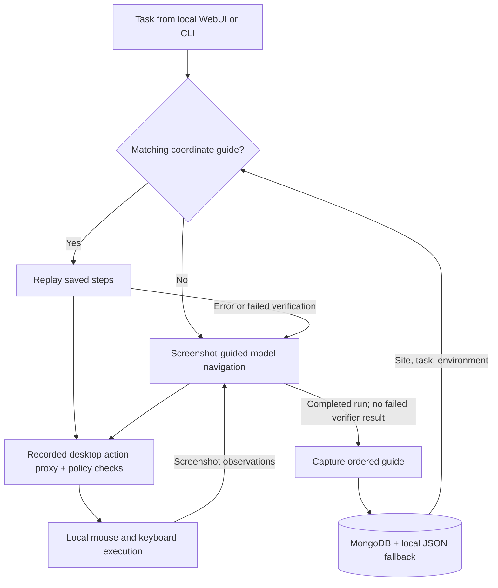

# Recursive Computer-Use Harness

**A desktop learning harness that remembers where to click and reuses the workflow.**

🏆 **3rd place — MongoDB Harness Engineering Hackathon**

An AI agent completes a task through screenshots, mouse clicks, and keyboard
actions. The harness captures those actions as a reusable **coordinate guide**:
an ordered map of where to click, what keys to press, and how to navigate.
On a matching task, it replays the saved guide before asking the model to
navigate again. If replay fails, it returns to screenshot-guided navigation
and can refresh the guide after completing the task.

**Stack:** Python · OpenAI-compatible vision models · PyAutoGUI · MongoDB ·
Standard-library HTTP server

[Gallery](#hackathon-gallery) · [Learning loop](#how-the-harness-learns) ·
[Demo walkthrough](#demo-walkthrough) · [Architecture](#architecture) ·
[Setup and operator guide](docs/operator-guide.md)

## Hackathon gallery

| Project presentation | Awards ceremony |
|---|---|
|  |  |

## The problem

A screenshot-driven agent can solve a task once and still reason through the
same navigation on its next attempt. Repeated tasks become repeated model calls,
and small interaction mistakes—such as typing into the wrong field—can derail
the workflow.

The harness gives that execution experience a reusable form. It captures the
agent's desktop actions, stores a guide for the task and machine environment,
and tries that guide on a later matching run. The learning happens in the
harness's workflow memory; model weights remain unchanged.

## My contribution

I owned the application and agent engineering; teammates handled the MongoDB
integration. My work covered:

- **Computer-use runtime:** the model/tool loop, persistent execution
  environment, screenshot observations, and desktop interaction.
- **Coordinate learning:** capture of ordered click and keyboard actions,
  saved guide lookup, replay, and refresh after a failed replay.
- **Local WebUI:** a browser chat for submitting tasks through the existing
  runtime, with explicit desktop arming and serialized desktop runs.
- **Runtime integration and testing:** recovery behavior, local task
  verification, demo flows, and fake-based tests for desktop execution.

The system described below is the combined team project. MongoDB persistence
and retrieval integration were teammate contributions.

## How the harness learns

1. **Observe and act.** On the first run, the model inspects screenshots and
   operates the desktop in short action groups.
2. **Capture the route.** The harness records the calls made through its
   desktop action proxy: clicks, typing, shortcuts, scrolling, and app launch.
3. **Save a guide.** After a completed run, it stores the ordered steps with
   the site, task key, and machine environment. A failed verifier result
   prevents guide capture.
4. **Replay the route.** On a matching run, the harness executes the guide's
   saved coordinates and keyboard actions. Selected parameterized steps use
   values from the current prompt.
5. **Recover and refresh.** If replay raises an error or configured verification
   reports failure, the agent falls back to screenshot-guided navigation.
   Completing that run can replace the saved guide.

### What the click map contains

| Guide component | Purpose |
|---|---|
| Ordered action steps | Preserve the sequence of clicks, keys, scrolling, and navigation |
| Click coordinates | Replay the captured target positions |
| Site and task key | Select a guide for a matching workflow |
| Environment fingerprint | Match the OS, screen dimensions, and display scaling |
| Parameter labels on supported steps | Fill navigation or prompt-supplied text during replay |
| Source run, timestamps, and counters | Trace the guide's origin and track replay outcomes |

Guides use MongoDB with a local JSON fallback at
`~/.recursive_computer_use/guides.json`. Most task keys currently derive from
the prompt text, so repeating the same prompt is the simplest way to exercise
guide reuse.

**Verification matters:** a guide can be saved after an unverified completed
run. Its existence and replay counters alone do not prove task success. When a
local verifier is configured, its result determines whether the task succeeded.
This is workflow learning; verified policy promotion is a separate runtime
capability.

## Demo walkthrough

The hackathon demonstration used the local WebUI:

1. **First run:** submit a website task and watch the agent navigate the
   desktop. Its action sequence becomes a saved guide after completion.
2. **Repeat run:** submit the same task in the same screen environment. The
   harness looks up the guide and attempts the stored route.
3. **Recovery:** if replay fails, the model resumes from screenshots and can
   capture a refreshed route after completing the task.

The [coordinate guide instructions](docs/operator-guide.md#coordinate-guide-replay)
explain replay options and storage. Use `--verbose` from the CLI to see guide
lookup, replay, and fallback messages.

The WebUI form currently has no verifier setting, so its default completed runs
are recorded as **unverified**. For deterministic task evidence, the
[local check-in demo](docs/operator-guide.md#optional-verified-policy-demo)
provides a localhost verifier.

## Architecture



Both navigation and guide replay use the same desktop execution boundary.
Replay takes screenshots between steps to satisfy the active screenshot
cadence; it does not ask the model to reason through every saved action.

## Engineering decisions

**Capture actual actions.** Guide capture hooks into the injected desktop
proxy after action authorization. This keeps the saved route tied to calls
that reached the execution boundary.
[Action proxy](src/recursive_computer_use/sandbox.py)

**Scope coordinates to the environment.** A guide's lookup key includes the
site, task, and an environment fingerprint. Screenshots on HiDPI displays are
resized to the logical coordinate space used for clicking. Environment matching
reduces mismatches, but it cannot guarantee that the UI layout is unchanged.
[Guide model](src/recursive_computer_use/guides.py) ·
[Screenshot scaling](src/recursive_computer_use/sandbox.py)

**Keep replay inside runtime limits.** Saved actions run through the same
proxy as model navigation. Recorded mouse and keyboard actions remain subject
to tool access, action budget, and screenshot cadence checks.
[Runtime and replay](src/recursive_computer_use/agent.py)

**Recover instead of endlessly retrying.** Replay failures return control to
the model. During navigation, repeated code, repeated errors, and actions with
no screen change trigger recovery hints; retry limits bound the run.
[Recovery monitor](src/recursive_computer_use/recovery.py)

**Keep workflow memory available during outages.** Guide reads prefer MongoDB
and fall back to local JSON. Writes attempt both stores, and persistence
failures remain non-fatal.
[Guide store](src/recursive_computer_use/guides.py)

## Explore the code

| Area | Entry point |
|---|---|
| Model loop, guide lookup, replay, and capture | [agent.py](src/recursive_computer_use/agent.py) |
| Desktop action recording and enforcement | [sandbox.py](src/recursive_computer_use/sandbox.py) |
| Coordinate guide models and persistence | [guides.py](src/recursive_computer_use/guides.py) |
| Local chat surface | [webui.py](src/recursive_computer_use/webui.py) |
| Stuck detection and bounded retries | [recovery.py](src/recursive_computer_use/recovery.py) |
| Local task verification | [verification.py](src/recursive_computer_use/verification.py) |

## Try it locally

Requires Python **3.13+**, a desktop session, and configured model credentials.
Direct application launching and accessibility element helpers currently target
macOS; cross-platform desktop behavior remains incomplete.

From the repository root:

```bash
python -m pip install -e .
python -m recursive_computer_use.webui
```

Configure credentials first using the
[authentication instructions](docs/operator-guide.md#model-authentication).
Open **http://127.0.0.1:8600**, enable **Arm desktop**, and submit a task.
This controls your real mouse and keyboard; use synthetic task data for demos.

Full installation, MongoDB setup, CLI options, and troubleshooting are in the
[operator guide](docs/operator-guide.md).

## Testing and limitations

Tests use fake desktop modules, stores, and model clients. The standard suite
does not require a real desktop, model endpoint, or live database; Atlas
integration tests are separately opt-in.

```bash
python -m unittest discover -s tests -v
python -m compileall -q src demo dashboard scripts
git diff --check
```

Representative tests cover
[guide capture and parameterized replay](tests/test_guide_capture_and_replay.py),
[action sanitization and enforcement](tests/test_recording.py), and
[recovery and verifier retries](tests/test_recovery.py).

Current limits:

- Coordinate replay depends on the screen environment and UI layout.
  A matching fingerprint cannot detect every moved control or changed page.
- Replay errors trigger fallback, but silent wrong clicks may go undetected
  without a task verifier. Capturing screenshots during replay is not itself
  a check that the task succeeded.
- Action telemetry omits typed text, but coordinate guides outside the
  LinkedIn-specific placeholder path can retain typed values and task text.
  Guide privacy handling needs further hardening.
- Desktop execution is local; selected screenshots still reach the configured
  model endpoint.
- The in-process Python namespace provides guardrails, not hardened OS
  isolation against adversarial prompts or model-generated code.

See the [operator guide](docs/operator-guide.md#privacy-and-safety-boundaries)
for data handling details and [design decisions](design-decision.md) for the
original model-loop rationale.
